# Readium Guide Writer

This skill produces user guides for the Readium Swift Toolkit that match the style and
quality of the existing guides in `docs/Guides/`.

## Research first

Before writing, gather what you need:

1. **Identify relevant source files.** Read the Swift interfaces (protocols, public types)
   for the feature — not the implementation, just the public API surface. Start in
   `Sources/` and look for types whose names match the feature. Also look at the files
   changed in the current branch, compared to the `develop` branch.
2. **Read related existing guides.** Check `docs/Guides/` for any guide that overlaps
   with the topic. These tell you what's already explained and where to cross-reference.
3. **Confirm the output path.** For example, guides for navigator topics go in
   `docs/Guides/Navigator/`. Ask the user if the right location is unclear.

## Structure

Every guide follows this shape:

```
# Feature Name

[One-paragraph summary of what this guide covers and what the reader will be able to do.]

> [!NOTE / IMPORTANT / WARNING / TIP as appropriate]
> Any critical caveats, prerequisites, or "read this before you start" points.

## First major concept (how to set up / what the API is)

### Sub-topic

## Second major concept (how to use the API)

### Sub-topic

## [Optional] Complete example

[Full, copy-pasteable working code that brings everything together]
```

## Writing style

**Tone**: Professional and direct, but approachable. Respect the reader's intelligence.
Address them as "you". Use "we" only when explaining Readium's own design decisions.

**Explain the why.** When the API requires a non-obvious approach, explain the reason:
"Readium does not have a concept of pages — instead, positions are used because..."

**Set expectations early.** Use "You are responsible for..." to clarify what the framework
doesn't do, so developers aren't surprised:
> "You are responsible for creating the view controller and adding it to your hierarchy."

**Avoid filler.** Don't pad with "In this guide, we will..." — the heading and first
paragraph already tell the reader what's covered.

## Code examples

- Use fenced Swift code blocks: ` ```swift `
- Show complete, runnable snippets — not pseudo-code or fragments with `...` unless a
  longer example truly needs ellipsis to stay focused.
- Include realistic variable names, error handling (`try/catch`), and optional chaining
  where the real code would need them.
- Don't explain what the code does in comments — let the surrounding prose do that.
  Only add a comment if it highlights a non-obvious subtlety.
- For a feature that has several steps, show each step as its own snippet, then provide
  a "Complete example" section at the end that combines them.
- **SwiftUI only.** When code examples involve UI, use SwiftUI — never UIKit directly.
  The Readium Navigator is UIKit-based internally, but bridging code (e.g.,
  `UIViewControllerRepresentable`) is acceptable when needed to host the navigator.
  Do not show raw UIKit view controller presentation patterns (e.g., `present(_:animated:)`).

## Callout blocks

Use GitHub-flavored alert syntax:

```markdown
> [!NOTE]
> Additional clarification that helps but isn't blocking.

> [!IMPORTANT]
> Something the developer must know to avoid a broken integration.

> [!WARNING]
> A gotcha that could cause subtle bugs or unexpected behavior.

> [!TIP]
> A helpful suggestion or recommended pattern.
```

Use these sparingly — one to three per guide is normal.

When generating the DocC site, `scripts/prepare-docc-catalog.py` converts them into DocC
asides (`> Important: …`). DocC has no caution aside, so prefer `WARNING` to `CAUTION`.

## Formatting conventions

| Element                           | Convention                                                                             |
|-----------------------------------|----------------------------------------------------------------------------------------|
| API type names, method names      | **`Publication`**, **`navigator.go(to:)`** — bold + backtick                           |
| Parameters and property names     | `locator`, `readingProgression` — backtick only                                        |
| UI concepts and user-facing terms | plain bold: **reading position**                                                       |
| File names and paths              | backtick: `TTSView.swift`                                                              |
| Tables                            | Pad cells with whitespaces to vertically align the columns                             |
| No horizontal rules               | Never use `---` to separate sections                                                   |
| Emoji                             | The character (✅), not a shortcode (`:white_check_mark:`), which DocC does not render |

## Diagrams

Add a diagram when a concept is easier to see than to read, such as how a structure is laid
out, nested or flattened. Prefer a few small diagrams, each answering one question, built on
the same worked example used by the prose and the code.

Write the diagrams in Mermaid, and commit them rendered to SVG: DocC does not render Mermaid.
Keep the Mermaid source in the guide, in an HTML comment immediately followed by the image:

````markdown

```mermaid
gantt
    dateFormat HH:mm:ss
    axisFormat %M:%S
    section Reading order
    track1.mp3 : 00:00:00, 00:20:00
    track2.mp3 : 00:20:00, 00:40:00
```

<!--

-->

````

- **Image path.** Put the SVG in the `Assets` folder next to the guide, and reference it
  with a Markdown image (``), not an `` tag, which DocC ignores.
  DocC only resolves images by file name, so `scripts/prepare-docc-catalog.py` strips the
  `Assets/` prefix from the image links. Prefix the file name with the guide topic
  (`timeline-…`), as it must be unique in the whole DocC catalog.
- **Alt text.** Describe what the diagram shows, for screen readers and readers of the raw
  Markdown.
- **No `-->` in the source.** It would close the HTML comment. In flowcharts, use thick
  arrows (`==>`) and thin them with `linkStyle default stroke-width:1px`.
- **Reserved words.** A Gantt task name starting with `section` (e.g. "Section 2.1") starts
  a new section: write its first letter as an entity code (`#83;ection 2.1`). A `:` in a task
  name breaks the line: rename the task.
- **Trees.** Disconnected trees are laid out independently, so siblings at the top level
  can end up on different levels. Link them to a shared root node, such as `toc.entries`.
  Don't name a `classDef` like a Mermaid class (`root`, `node`, `cluster`): its style
  applies to the whole diagram.
- **Timelines.** A Gantt chart with `dateFormat HH:mm:ss` draws ranges on a time axis. Add
  `displayMode: compact` in a front matter to draw the tasks of a section on a single row.
  For a unit other than time, such as positions, map each unit to a second and label the
  axis with `axisFormat %-S` and `tickInterval 5second`.
- **Colors.** The tags of a Gantt task pick its color: untagged tasks are dark blue (e.g.
  the reading order), `active` tasks light blue (e.g. entries) and `done` tasks gray (e.g.
  "no entry"). The script alternates the shade of the bars touching each other on a row, so
  that their boundaries stand out. Don't hard-code colors in a `classDef`, except a gray
  text or `fill:none`: the diagram is also rendered with a dark palette.

After adding or changing a diagram, render the SVGs of the guide with:

```bash
python3 -I .claude/skills/write-guide/scripts/render-diagrams.py "docs/Guides/Guide Name.md"
```

The script requires Node.js (it runs the Mermaid CLI with `npx`) and Google Chrome, or a
Chrome binary in `PUPPETEER_EXECUTABLE_PATH`. It renders every diagram of the guide with a
shared theme, and gives the SVGs a fixed size, as DocC shrinks the fluid SVGs of Mermaid to
a thumbnail. It also renders a dark variant of each diagram, `Assets/name~dark.svg`, which
DocC displays in dark mode. Commit both. Look at each rendered SVG before committing it:
labels can overflow short bars or boxes.

## Cross-references

Link to related guides using relative paths:

```markdown
See the [Navigator guide](Navigator/Navigator.md) for details on positioning.
```

These links work on GitHub. When generating the DocC site, `scripts/prepare-docc-catalog.py`
rewrites them into DocC links (`doc:Navigator`), including the anchors of headings, and
links to files outside `docs/` into links to the repository on GitHub. Check that the path
is correct relative to the guide: the script warns about links it cannot resolve. You can
check a guide without building the whole site:

```bash
mkdir -p /tmp/docc/Readium.docc && cp -R docs/* /tmp/docc/Readium.docc/
python3 -I scripts/prepare-docc-catalog.py /tmp/docc/Readium.docc https://github.com/readium/swift-toolkit/blob/develop
xcrun docc convert /tmp/docc/Readium.docc --output-dir /tmp/docc/out
```

Only the warnings about the missing `Readium*` modules are expected, as this skips the API
reference.

When you mention a concept that is covered in depth elsewhere, add a short cross-reference
rather than re-explaining it. Don't assume the reader has read other guides — give a one-
sentence summary and point them there.

## Terminology

Capitalize these terms consistently:
- **Navigator** — the Readium component/protocol (always capitalized)
- **Publication** — the API type (`Publication`) capitalized; "publication" lowercase when
  referring to the content generically
- **Locator** — the type; "location" when speaking generically

## Output

Before writing the guide files, confirm the structure and outline of all the produced files
with the users, and ask if changes are required.

After confirmation, write the guides to the appropriate path under `docs/Guides/`. Then add
links to them in these two index files:

- **`README.md`** — under the appropriate section in the "User Guides" list. Match the
  existing bullet format: `* [Title](docs/Guides/Path/To/Guide.md) – one-line description`.
- **The appropriate DocC root file under `docs/`** — read the `.md` files at the root of
  `docs/` to identify which one covers the topic area (e.g. a Navigator overview file for
  navigator guides). Add a `- <doc:Guide-Name>` entry under the matching `### Topic` group.
  The DocC slug is the filename with spaces replaced by hyphens and the `.md` extension
  removed.

After writing all files, **review every guide you created or modified**:
- Verify that every type, method, and property name mentioned in prose or code actually
  exists in the current source files (search `Sources/` to confirm).
- Check that code examples are syntactically plausible and use the API correctly.
- Flag any discrepancy to the user rather than silently guessing.

Finally, briefly tell the user what you wrote and which existing guides you linked to, in
case they want to update those guides to add a reciprocal link.
