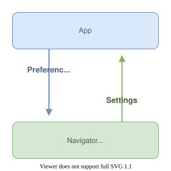

# Configuring the Navigator

Take a look at the [migration guide](../../Migration%20Guide.md) if you are already using the legacy EPUB settings.

## Overview

The Readium Navigator can be configured dynamically, as it implements the `Configurable` protocol.

You cannot directly overwrite the Navigator settings. Instead, you submit a set of `Preferences` to the Navigator, which will then recalculate its settings and update the presentation.

For instance: "font size" is a **setting**, and the application can submit the font size value `150%` as a **preference**.



```swift
// 1. Create a set of preferences.
let preferences = EPUBPreferences(
    fontFamily: .serif,
    fontSize: 2.0,
    textAlign: .justify
)

// 2. Submit the preferences, the Navigator will update its settings and the presentation.
epubNavigator.submitPreferences(preferences)

// 3. Read the new settings.
assert(epubNavigator.settings.fontFamily == .serif)
```

### Editing preferences

Your app owns the values chosen by the user. Edit them in your own settings model, then derive the `Preferences` from it before submitting them to the Navigator (see [Save and restore the user preferences](#save-and-restore-the-user-preferences)).

```swift
var settings = ReaderSettings()
settings.fontSize = 1.2

epubNavigator.submitPreferences(settings.preferences())
```

### Preferences are low-level

Preferences are low-level technical properties. While some of them can be exposed directly to the user, such as the font size, others should not be displayed as-is.

For instance, in EPUB, we can simulate two pages side by side using the `columnCount` property (`nil` for automatic, or a number of columns) for reflowable resources, and the `spread` (`auto`, `never`, `always`) property for fixed-layout publications. Rather than displaying both of these settings with all of their possible values in the user interface, you might prefer to show a single switch button to enable a dual-page mode, which will set both settings appropriately.

### Inactive settings

A setting may be inactive if its activation conditions are not met. The Navigator will ignore inactive settings when updating its presentation. For example, with the EPUB navigator, the `hyphens` setting is effective only with a left-to-right layout, and `columnCount` only in paginated mode.

To check if a setting is effective, resolve the settings that the Navigator would apply to the publication with your preferences, then call **`isEffective(_:)`** with the key path of the setting.

```swift
let settings = EPUBSettings(
    publication: publication,
    preferences: preferences,
    defaults: defaults
)

settings.isEffective(\.wordSpacing)
```

**`isEffective(_:)`** tells whether a setting would take effect if it was set, with this publication and the other settings. It doesn't tell whether the user set it, as your model already knows it. Use it to disable the controls of the inactive settings. **`PDFSettings(publication:preferences:defaults:)`** works the same way, and the audio settings are always effective.

> [!IMPORTANT]
> Give the same `defaults` as the Navigator configuration. If you give a custom reading order to the EPUB navigator, or a `preferredResourceVariant` in its configuration, the rendered reading order differs from the publication's: give **`EPUBNavigatorViewController.readingOrder`** as the `readingOrder` too, as a publication can mix reflowable and fixed-layout resources. Otherwise, **`isEffective(_:)`** may not match the Navigator. Note that the EPUB navigator also forces the scroll mode when VoiceOver is running, which the resolved settings don't reflect.

## Setting the initial Navigator preferences and app defaults

When opening a publication, you can immediately apply the user preferences by providing them to the Navigator constructor. The API for doing this varies depending on the Navigator implementation, but generally looks like this:

```swift
let navigator = try EPUBNavigatorViewController(
    publication: publication,
    config: .init(
        preferences: EPUBPreferences(
            language: Language("fr")
        ),
        defaults: EPUBDefaults(
            pageMargins: 1.5,
            scroll: true
        )
    )
)
```

The `defaults` are used as fallback values when the default Navigator settings are not suitable for your application.

## Build a user settings interface

❓ The following example uses SwiftUI, but could be implemented using UIKit as well.

A row of your settings screen binds a control to a value of your settings model, and is disabled when the setting is not effective. When the user didn't set the value, the row can display the setting resolved by the Navigator, or a starting value for the optional settings, as suggested in the documentation of each property of the `Preferences` types.

```swift
struct ScrollRow: View {
    @Binding var settings: ReaderSettings
    let publication: Publication
    let defaults: EPUBDefaults

    var body: some View {
        let navigatorSettings = EPUBSettings(
            publication: publication,
            preferences: settings.preferences(),
            defaults: defaults
        )

        Toggle("Scroll", isOn: Binding(
            get: { settings.scroll ?? navigatorSettings.scroll },
            set: { settings.scroll = $0 }
        ))
        .disabled(!navigatorSettings.isEffective(\.scroll))
    }
}
```

When `settings` changes, save it and submit its preferences to the Navigator. Resolving the settings is cheap, so you can do it every time the view is updated.

The [Test App](../../../TestApp/Sources/Reader/Common/Preferences/UserPreferences.swift) has a complete settings screen for the EPUB, PDF and audio navigators.

## Save and restore the user preferences

The `Preferences` types are not `Codable`: they are low-level navigator inputs which rarely map 1-1 to the settings of your user interface. Instead, your app owns a settings model, persisted the way you want, from which it derives the `Preferences` before submitting them to the navigator.

```swift
struct ReaderSettings: Codable {
    enum Theme: String, Codable {
        case light, sepia, dark
    }

    var theme: Theme = .light
    var fontSize: Double?
    var scroll: Bool?

    func preferences() -> EPUBPreferences {
        let (textColor, backgroundColor): (Color?, Color?) = switch theme {
        case .light: (nil, nil)
        case .sepia: (Color(hex: "#121212"), Color(hex: "#FAF4E8"))
        case .dark: (Color(hex: "#FEFEFE"), Color(hex: "#000000"))
        }

        return EPUBPreferences(
            backgroundColor: backgroundColor,
            fontSize: fontSize,
            scroll: scroll,
            textColor: textColor
        )
    }
}

// Save the settings chosen by the user.
var settings = ReaderSettings()
settings.theme = .sepia
let jsonData = try JSONEncoder().encode(settings)

// Later, when opening a publication:
let restoredSettings = try JSONDecoder().decode(ReaderSettings.self, from: jsonData)
navigator.submitPreferences(restoredSettings.preferences())
```

Your model decides what is persisted: a theme or a dual-page toggle can drive several preferences, and you are free to rename, add or drop settings without depending on the toolkit's serialization format.

### Preferences specific to a publication

The way you store user settings can affect the available features. You could have, for example:

* A unique set of settings for each publication.
* Settings shared between publications with the same profile or media type (EPUB, PDF, etc.).
* Global settings shared with all publications (e.g. colors).
* Several user setting profiles/themes that the user can switch between and modify independently.

Some preferences are closely tied to a specific publication and should never be shared between multiple publications. It is recommended that you store them separately per book:

| Navigator | Preferences specific to a publication                                         |
|-----------|-------------------------------------------------------------------------------|
| EPUB      | `language`, `offsetFirstPage`, `readingProgression`, `spread`, `verticalText` |
| PDF       | `offsetFirstPage`, `readingProgression`                                       |
| Audio     | None                                                                          |

## Appendix: Preference constraints

### EPUB

#### Reflowable vs fixed-layout

EPUB comes in two very different flavors: **reflowable** which allows a lot of customization, and **fixed-layout** which is similar to a PDF or a comic book. Depending on the EPUB being rendered, the Navigator will ignore some of the preferences.

An EPUB can also mix both kinds of resources in a single publication. In this case, a preference is effective as soon as at least one resource of the matching kind is in the reading order, and it applies only to those resources. For example, `fontSize` is effective in a fixed-layout publication containing a reflowable chapter, but it changes only that chapter.

Bitmaps and SVG documents in the reading order are always rendered as fixed-layout pages, even in a reflowable publication, so the fixed-layout preferences apply to them and the reflowable ones don't.

| Setting              | Reflowable | Fixed Layout |
|----------------------|------------|--------------|
| `backgroundColor`    | ✅         | ✅           |
| `blendImages`        | ✅         |              |
| `columnCount`        | ✅         |              |
| `darkenImages`       | ✅         |              |
| `fit`                |            | ✅           |
| `fontFamily`         | ✅         |              |
| `fontSize`           | ✅         |              |
| `fontWeight`         | ✅         |              |
| `fontWidth`          | ✅         |              |
| `hyphens`            | ✅         |              |
| `invertGaiji`        | ✅         |              |
| `invertImages`       | ✅         |              |
| `language`           | ✅         | ✅           |
| `letterSpacing`      | ✅         |              |
| `ligatures`          | ✅         |              |
| `lineHeight`         | ✅         |              |
| `linkColor`          | ✅         |              |
| `maximalLineLength`  | ✅         |              |
| `minimalLineLength`  | ✅         |              |
| `noRuby`             | ✅         |              |
| `offsetFirstPage`    |            | ✅           |
| `optimalLineLength`  | ✅         |              |
| `pageMargins`        | ✅         |              |
| `paragraphIndent`    | ✅         |              |
| `paragraphSpacing`   | ✅         |              |
| `readingProgression` | ✅         | ✅           |
| `scroll`             | ✅         |              |
| `spread`             |            | ✅           |
| `textAlign`          | ✅         |              |
| `textColor`          | ✅         |              |
| `textNormalization`  | ✅         |              |
| `verticalText`       | ✅         |              |
| `visitedColor`       | ✅         |              |
| `wordSpacing`        | ✅         |              |

#### Optional settings

The following settings are `nil` when they are unset in both the preferences and the defaults. The Navigator then observes the publisher styles, whose values are unknown to the toolkit. **`isEffective(_:)`** tells whether they would take effect once set.

* `backgroundColor`
* `fontFamily`
* `fontWeight`
* `fontWidth` (only fonts with a width axis support it, typically variable fonts)
* `hyphens` (Readium CSS hyphenates the justified text when unset)
* `letterSpacing`
* `ligatures`
* `lineHeight`
* `linkColor`
* `paragraphIndent`
* `paragraphSpacing`
* `textAlign`
* `textColor`
* `visitedColor`
* `wordSpacing`

#### Scroll vs paginated

Some preferences are available only in paginated mode (`scroll = false`).

| Preference          | Scroll | Paginated                                 |
|---------------------|--------|-------------------------------------------|
| `columnCount`       |        | ✅                                        |
| `optimalLineLength` |        | ✅ (when `columnCount` is `nil`)          |
| `minimalLineLength` |        | ✅ (when `columnCount` is greater than 1) |
| `maximalLineLength` | ✅     | ✅                                        |

#### Line length and margins

The navigator chooses the number of columns and the length of the lines from the viewport size and the font size, to keep the lines comfortable to read. A larger font displays fewer columns, with about the same number of characters per line. In automatic mode (`columnCount` is `nil`), the navigator displays as many columns as the viewport can hold. On foldable devices, it displays one column on each side of the hinge.

You can adjust this layout with the following preferences. The line length preferences are factors of reference lengths chosen by the navigator, so `1.0` keeps the reference length.

* `optimalLineLength` is the target line length used to choose the number of columns, in automatic mode. Increase it to display fewer and wider columns.
* `maximalLineLength` limits the length of the lines, in both scroll and paginated modes. The remaining space is added to the margins. It is `1.0` by default. To let the lines take all the available width, set `EPUBDefaults.maximalLineLength` to `nil`.
* `minimalLineLength` prevents the lines from becoming too short when you request several columns with `columnCount`: fewer columns are displayed if the lines would be shorter. When `nil` (the default), the requested number of columns is always displayed.
* `pageMargins` scales the minimal margins on each side of the lines. The margins are larger when the line length is limited, and never smaller than the safe area insets.

With vertical text, the line length is the height of the lines, and the margins are at the top and bottom.

#### Colors and themes

The EPUB navigator has no themes. Instead, it offers four color preferences: `textColor`, `backgroundColor`, `linkColor` and `visitedColor`.

* A color which is set overrides the colors of the publication.
* When a color is unset, the one of the publication is kept.
* Each color is applied on its own. If you set only the `backgroundColor`, make sure the text of the publication remains readable, or set the `textColor` too.

A theme is therefore a set of colors that your app applies together. For example:

```swift
/// A set of colors applied together. `nil` keeps the color of the publication.
struct ReaderTheme: Equatable {
    typealias Color = ReadiumNavigator.Color

    var textColor: Color?
    var backgroundColor: Color?
    var linkColor: Color?
    var visitedColor: Color?

    static let light = ReaderTheme()

    static let sepia = ReaderTheme(
        textColor: Color(hex: "#121212"),
        backgroundColor: Color(hex: "#FAF4E8")
    )

    static let dark = ReaderTheme(
        textColor: Color(hex: "#FEFEFE"),
        backgroundColor: Color(hex: "#000000"),
        linkColor: Color(hex: "#63CAFF"),
        visitedColor: Color(hex: "#0099E5")
    )
}

extension EPUBPreferences {
    /// Sets the colors of the `theme`. `nil` clears a color preference.
    mutating func apply(_ theme: ReaderTheme) {
        textColor = theme.textColor
        backgroundColor = theme.backgroundColor
        linkColor = theme.linkColor
        visitedColor = theme.visitedColor
    }
}
```

Store the theme selected by the user in your settings model, and apply it when deriving the preferences.

#### Image filters

The image filter preferences are applied with any colors. `darkenImages`, `invertGaiji` and `invertImages` are typically used with a dark `backgroundColor`: to filter the images only with your dark theme, set these preferences along with its colors and clear them otherwise.

* `blendImages` blends the images (`` and `<svg>`) with the background color when `true`, so that their white areas take the color of the page, for example with a sepia background. It is meant for light backgrounds, as the images become very dark on a dark one.
* `darkenImages` reduces the brightness of the images by the given percentage, from `0.0` to `1.0`.
* `invertGaiji` inverts the colors of the gaiji only when `true`. The gaiji are the images used in Japanese publications for the characters missing from the fonts (``). They are usually black glyphs displayed among the text, which are hard to read on a dark background unless inverted. When `invertGaiji` is `true`, the gaiji ignore `darkenImages` and `invertImages`.
* `invertImages` inverts the colors of the images when `true`.

#### Language specific preferences

Some preferences are not available for all languages and layout.

| Preference          | LTR | RTL | CJK |
|---------------------|-----|-----|-----|
| `hyphens`           | ✅  |     |     |
| `letterSpacing`     | ✅  |     | ✅  |
| `ligatures`         | ✅  | ✅  |     |
| `noRuby`            |     |     | ✅  |
| `paragraphIndent`   | ✅  | ✅  |     |
| `textAlign`         | ✅  | ✅  |     |
| `textNormalization` | ✅  |     |     |
| `wordSpacing`       | ✅  | ✅  |     |

### PDF

#### Scroll vs paginated

Some preferences are available only in scroll or paginated mode (`scroll = false`).

| Preference           | Vertical Scroll | Horizontal Scroll | Paginated |
|----------------------|-----------------|-------------------|-----------|
| `fit`                | ✅              | ✅                |           |
| `offsetFirstPage`    | ✅              |                   | ✅        |
| `readingProgression` |                 |                   | ✅        |
| `spread`             | ✅              |                   | ✅        |
| `scrollAxis`         | ✅              | ✅                |           |
| `visibleScrollbar`   | ✅              | ✅                |           |

`offsetFirstPage` is also inactive when `spread` is `.never`.
