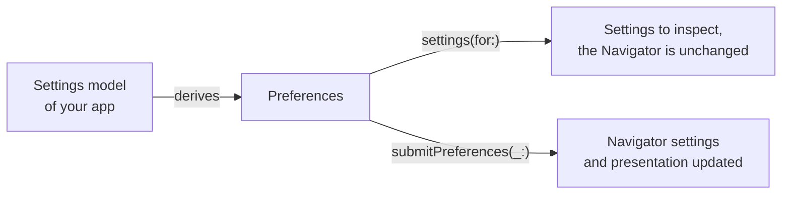

# Configuring the Navigator

The Readium Navigators can be configured while reading, for example to change the font size, the colors or the scroll mode. This guide explains how to submit the user preferences to a Navigator, how to build a settings screen which tells the user which settings take effect with the current publication, and how to persist the user preferences.

## Overview

The navigators implement the **`Configurable`** protocol. You cannot overwrite the **settings** of a Navigator directly. Instead, you submit a set of **preferences**, from which the Navigator computes its settings and updates the presentation.

For instance, "font size" is a setting, and your app can submit the font size value `150%` as a preference. The Navigator may ignore a preference, or adjust it: a preference set to an invalid value is replaced, and a setting can depend on the publication or on other settings.

<!--

-->


Each Navigator has its own types:

| Navigator                            | Preferences               | Settings               | Defaults               |
|--------------------------------------|---------------------------|------------------------|------------------------|
| **`EPUBNavigatorViewController`**    | **`EPUBPreferences`**     | **`EPUBSettings`**     | **`EPUBDefaults`**     |
| **`PDFNavigatorViewController`**     | **`PDFPreferences`**      | **`PDFSettings`**      | **`PDFDefaults`**      |
| **`AudioNavigator`**                 | **`AudioPreferences`**    | **`AudioSettings`**    | **`AudioDefaults`**    |

A typical integration follows these steps:

1. Your app owns a **settings model** holding the values chosen by the user, which it persists the way it wants.
2. It derives the `Preferences` of the Navigator from this model.
3. **(Optional)** It asks the Navigator which settings these preferences would produce with **`settings(for:)`**, to inspect them in its settings screen.
4. It submits the preferences with **`submitPreferences(_:)`**. The Navigator recomputes its settings and updates the presentation.

```swift
let preferences = EPUBPreferences(
    fontFamily: .serif,
    fontSize: 2.0,
    textAlign: .justify
)

let settings = epubNavigator.settings(for: preferences)
if settings.isEffective(\.textAlign) {
    // The text alignment takes effect with this publication.
}

epubNavigator.submitPreferences(preferences)
assert(epubNavigator.settings.fontFamily == .serif)
```

### Preferences are low-level

Preferences are low-level technical properties. While some of them can be exposed directly to the user, such as the font size, others should not be displayed as-is.

For instance, in EPUB, you can display two pages side by side using the `columnCount` preference (`nil` for automatic, or a number of columns) for reflowable resources, and the `spread` preference (`auto`, `never`, `always`) for fixed-layout publications. Rather than displaying both of these preferences with all of their possible values, you might prefer to show a single switch to enable a dual-page mode, which sets both preferences.

This is why your app owns its settings model, rather than storing the `Preferences` directly. See the `dualPage` setting in the [example below](#save-and-restore-the-user-preferences).

## Save and restore the user preferences

The `Preferences` types are not `Codable`: they are Navigator inputs which rarely map 1-1 to the settings of your user interface. Your app owns a settings model, persisted the way you want, from which it derives the `Preferences`.

```swift
struct ReaderSettings: Codable, Equatable {
    typealias Color = ReadiumNavigator.Color

    enum Theme: String, Codable {
        case light, sepia, dark
    }

    var theme: Theme = .light
    var dualPage: Bool?
    var fontSize: Double?
    var lineHeight: Double?
    var scroll: Bool?

    func preferences() -> EPUBPreferences {
        let (textColor, backgroundColor): (Color?, Color?) = switch theme {
        case .light: (nil, nil)
        case .sepia: (Color(hex: "#121212"), Color(hex: "#FAF4E8"))
        case .dark: (Color(hex: "#FEFEFE"), Color(hex: "#000000"))
        }

        let (columnCount, spread): (Int?, Spread?) = switch dualPage {
        case true?: (2, .always)
        case false?: (1, .never)
        case nil: (nil, nil)
        }

        return EPUBPreferences(
            backgroundColor: backgroundColor,
            columnCount: columnCount,
            fontSize: fontSize,
            lineHeight: lineHeight,
            scroll: scroll,
            spread: spread,
            textColor: textColor
        )
    }
}
```

A `nil` value means that the user didn't choose a value: the Navigator then falls back on the publication or on its defaults. Your model decides what is persisted. A setting of your model can drive several preferences: the `theme` sets the colors, and `dualPage` sets both the `columnCount` of the reflowable resources and the `spread` of the fixed-layout ones.

### Preferences specific to a publication

The way you store the user settings affects the available features. You could have, for example:

* A unique set of settings for each publication.
* Settings shared between publications with the same profile or media type (EPUB, PDF, etc.).
* Global settings shared with all publications (e.g. a theme).
* Several user setting profiles or themes that the user can switch between and modify independently.

Some preferences are tied to a specific publication and should never be shared between publications. Store them separately for each book:

| Navigator | Preferences specific to a publication                                         |
|-----------|-------------------------------------------------------------------------------|
| EPUB      | `language`, `offsetFirstPage`, `readingProgression`, `spread`, `verticalText` |
| PDF       | `offsetFirstPage`, `readingProgression`                                       |
| Audio     | None                                                                          |

## Setting the initial Navigator preferences and app defaults

When opening a publication, give the restored user preferences to the Navigator configuration, so that they apply from the first render. The API varies between the Navigators, but generally looks like this:

```swift
let navigator = try EPUBNavigatorViewController(
    publication: publication,
    initialLocation: lastReadLocation,
    config: .init(
        preferences: restoredSettings.preferences(),
        defaults: EPUBDefaults(
            pageMargins: 1.5,
            scroll: true
        )
    )
)
```

The `defaults` replace the default values of the Navigator when they don't suit your app. A setting takes the value of its preference first, then the one of the publication metadata when relevant (such as the `language`), then the default value.

## Build a user settings interface

You are responsible for the settings screen: its controls, ranges and formatting are choices of your user interface. The Navigator tells you which settings take effect with the current publication, and which values it would apply.

### Inspect the settings before submitting them

**`settings(for:)`** returns the settings that the Navigator would apply if you submitted the given preferences, without changing its presentation. So right after `navigator.submitPreferences(preferences)`, `navigator.settings` is equal to `navigator.settings(for: preferences)`.

Call it with the preferences derived from your settings model, to inspect the choices of the user before submitting them. `navigator.settings` only reflects the last submitted preferences.

### Inactive settings

A setting is inactive when its activation conditions are not met, and the Navigator then ignores it. For example, with the EPUB Navigator, the `hyphens` setting is effective only with a left-to-right layout, and `columnCount` only in paginated mode.

To check if a setting is effective, call **`isEffective(_:)`** on the settings with the key path of the setting:

```swift
let settings = navigator.settings(for: readerSettings.preferences())
let isEnabled = settings.isEffective(\.wordSpacing)
```

**`isEffective(_:)`** tells whether a setting would take effect if it was set, with this publication and the other settings. It doesn't tell whether the user set it, as your settings model already knows it. For example, `textColor` is effective in a reflowable publication even when unset. Use it to disable the controls of the inactive settings.

The [appendix](#appendix-preference-constraints) lists the rules of each setting.

### Display the values of the unset settings

When the user didn't choose a value, your control still needs one to display. In this order, you can show:

1. The value of your settings model, when the user chose one.
2. The value resolved by the Navigator, in the settings returned by **`settings(for:)`**. It comes from the publication or the `defaults` of the Navigator.
3. A starting value, for the [optional settings](#optional-settings) which are `nil` when unset.

The documentation of each property of the `Preferences` types suggests a range, a step and a starting value for your controls.

### Example of settings controls

A control of your settings screen binds to a value of your settings model, and is disabled when the setting is not effective. The following controls receive the settings resolved by the Navigator, which the [view model](#submit-the-changes) resolves once for the whole screen.

```swift
struct ScrollToggle: View {
    @Binding var settings: ReaderSettings
    let navigatorSettings: EPUBSettings

    var body: some View {
        Toggle("Scroll", isOn: Binding(
            get: { settings.scroll ?? navigatorSettings.scroll },
            set: { settings.scroll = $0 }
        ))
        .disabled(!navigatorSettings.isEffective(\.scroll))
    }
}
```

The line height is an optional setting: when neither the user nor the `defaults` set it, the stepper starts from `1.5`, the starting value suggested by **`EPUBPreferences.lineHeight`**. A reset button clears the value of the user, to restore the line height of the publication or of your `defaults`.

```swift
struct LineHeightStepper: View {
    @Binding var settings: ReaderSettings
    let navigatorSettings: EPUBSettings

    var body: some View {
        let lineHeight = settings.lineHeight ?? navigatorSettings.lineHeight ?? 1.5

        HStack {
            Stepper(
                "Line height: \(lineHeight.formatted(.number.precision(.fractionLength(1))))",
                value: Binding(
                    get: { lineHeight },
                    set: { settings.lineHeight = $0 }
                ),
                in: 1.0 ... 2.0,
                step: 0.1
            )

            Button("Reset") {
                settings.lineHeight = nil
            }
            .disabled(settings.lineHeight == nil)
        }
        .disabled(!navigatorSettings.isEffective(\.lineHeight))
    }
}
```

### Submit the changes

When the settings model changes, the view model saves it, resolves the settings of the Navigator once for all the controls, and submits the preferences to the Navigator, which updates the presentation:

```swift
@MainActor
final class ReaderSettingsViewModel: ObservableObject {
    private let navigator: EPUBNavigatorViewController
    private let save: (ReaderSettings) -> Void

    @Published var settings: ReaderSettings {
        didSet {
            guard settings != oldValue else {
                return
            }
            save(settings)
            let preferences = settings.preferences()
            navigatorSettings = navigator.settings(for: preferences)
            navigator.submitPreferences(preferences)
        }
    }

    /// Settings resolved by the Navigator from `settings`, inspected by the controls.
    @Published private(set) var navigatorSettings: EPUBSettings

    init(
        settings: ReaderSettings,
        navigator: EPUBNavigatorViewController,
        save: @escaping (ReaderSettings) -> Void
    ) {
        self.settings = settings
        self.navigator = navigator
        self.save = save
        navigatorSettings = navigator.settings(for: settings.preferences())
    }
}

struct ReaderSettingsView: View {
    @ObservedObject var viewModel: ReaderSettingsViewModel

    var body: some View {
        Form {
            ScrollToggle(settings: $viewModel.settings, navigatorSettings: viewModel.navigatorSettings)
            LineHeightStepper(settings: $viewModel.settings, navigatorSettings: viewModel.navigatorSettings)
        }
    }
}
```

The [Test App](../../../TestApp/Sources/Reader/Common/Preferences/UserPreferences.swift) has a complete settings screen for the EPUB, PDF and audio Navigators.

## EPUB preferences

### Line length and margins

The EPUB Navigator chooses the number of columns and the length of the lines from the viewport size and the font size, to keep the lines comfortable to read. A larger font displays fewer columns, with about the same number of characters per line. In automatic mode (`columnCount` is `nil`), the Navigator displays as many columns as the viewport can hold. On foldable devices, it displays one column on each side of the hinge.

You can adjust this layout with the following preferences. The line length preferences are factors of reference lengths chosen by the Navigator, so `1.0` keeps the reference length.

* `optimalLineLength` is the target line length used to choose the number of columns, in automatic mode. Increase it to display fewer and wider columns.
* `maximalLineLength` limits the length of the lines, in both scroll and paginated modes. The remaining space is added to the margins. It is `1.0` by default. To let the lines take all the available width, set `EPUBDefaults.maximalLineLength` to `nil`.
* `minimalLineLength` prevents the lines from becoming too short when you request several columns with `columnCount`: fewer columns are displayed if the lines would be shorter. When `nil` (the default), the requested number of columns is always displayed.
* `pageMargins` scales the minimal margins on each side of the lines. The margins are larger when the line length is limited, and never smaller than the safe area insets.

With vertical text, the line length is the height of the lines, and the margins are at the top and bottom.

### Colors and themes

The EPUB Navigator has no themes. Instead, it offers four color preferences: `textColor`, `backgroundColor`, `linkColor` and `visitedColor`.

* A color which is set overrides the colors of the publication.
* When a color is unset, the one of the publication is kept.
* Each color is applied on its own. If you set only the `backgroundColor`, make sure the text of the publication remains readable, or set the `textColor` too.

A theme is therefore a set of colors that your app applies together. For example:

```swift
/// A set of colors applied together. `nil` keeps the color of the publication.
struct ReaderTheme: Equatable {
    typealias Color = ReadiumNavigator.Color

    var textColor: Color?
    var backgroundColor: Color?
    var linkColor: Color?
    var visitedColor: Color?

    static let light = ReaderTheme()

    static let sepia = ReaderTheme(
        textColor: Color(hex: "#121212"),
        backgroundColor: Color(hex: "#FAF4E8")
    )

    static let dark = ReaderTheme(
        textColor: Color(hex: "#FEFEFE"),
        backgroundColor: Color(hex: "#000000"),
        linkColor: Color(hex: "#63CAFF"),
        visitedColor: Color(hex: "#0099E5")
    )
}

extension EPUBPreferences {
    /// Sets the colors of the `theme`. `nil` clears a color preference.
    mutating func apply(_ theme: ReaderTheme) {
        textColor = theme.textColor
        backgroundColor = theme.backgroundColor
        linkColor = theme.linkColor
        visitedColor = theme.visitedColor
    }
}
```

Store the theme selected by the user in your settings model, and apply it when deriving the preferences.

### Image filters

The image filter preferences are applied with any colors. `darkenImages`, `invertGaiji` and `invertImages` are typically used with a dark `backgroundColor`: to filter the images only with your dark theme, set these preferences along with its colors and clear them otherwise.

* `blendImages` blends the images (`` and `<svg>`) with the background color when `true`, so that their white areas take the color of the page, for example with a sepia background. It is meant for light backgrounds, as the images become very dark on a dark one.
* `darkenImages` reduces the brightness of the images by the given percentage, from `0.0` to `1.0`.
* `invertGaiji` inverts the colors of the gaiji only when `true`. The gaiji are the images used in Japanese publications for the characters missing from the fonts (``). They are usually black glyphs displayed among the text, which are hard to read on a dark background unless inverted. When `invertGaiji` is `true`, the gaiji ignore `darkenImages` and `invertImages`.
* `invertImages` inverts the colors of the images when `true`.

## Appendix: Preference constraints

**`isEffective(_:)`** implements the following rules, which tell when a preference is ignored by the Navigator.

### EPUB

#### Reflowable vs fixed-layout

EPUB comes in two very different flavors: **reflowable** which allows a lot of customization, and **fixed-layout** which is similar to a PDF or a comic book. Depending on the EPUB being rendered, the Navigator ignores some of the preferences.

An EPUB can also mix both kinds of resources in a single publication. In this case, a preference is effective as soon as at least one resource of the matching kind is in the reading order rendered by the Navigator, and it applies only to those resources. For example, `fontSize` is effective in a fixed-layout publication containing a reflowable chapter, but it changes only that chapter.

Bitmaps and SVG documents in the reading order are always rendered as fixed-layout pages, even in a reflowable publication, so the fixed-layout preferences apply to them and the reflowable ones don't.

| Setting              | Reflowable | Fixed Layout                       |
|----------------------|------------|------------------------------------|
| `backgroundColor`    | ✅         | ✅                                 |
| `blendImages`        | ✅         |                                    |
| `columnCount`        | ✅         |                                    |
| `darkenImages`       | ✅         |                                    |
| `fit`                |            | ✅                                 |
| `fontFamily`         | ✅         |                                    |
| `fontSize`           | ✅         |                                    |
| `fontWeight`         | ✅         |                                    |
| `fontWidth`          | ✅         |                                    |
| `hyphens`            | ✅         |                                    |
| `invertGaiji`        | ✅         |                                    |
| `invertImages`       | ✅         |                                    |
| `language`           | ✅         | ✅                                 |
| `letterSpacing`      | ✅         |                                    |
| `ligatures`          | ✅         |                                    |
| `lineHeight`         | ✅         |                                    |
| `linkColor`          | ✅         |                                    |
| `maximalLineLength`  | ✅         |                                    |
| `minimalLineLength`  | ✅         |                                    |
| `noRuby`             | ✅         |                                    |
| `offsetFirstPage`    |            | ✅ (when `spread` is not `.never`) |
| `optimalLineLength`  | ✅         |                                    |
| `pageMargins`        | ✅         |                                    |
| `paragraphIndent`    | ✅         |                                    |
| `paragraphSpacing`   | ✅         |                                    |
| `readingProgression` | ✅         | ✅                                 |
| `scroll`             | ✅         |                                    |
| `spread`             |            | ✅                                 |
| `textAlign`          | ✅         |                                    |
| `textColor`          | ✅         |                                    |
| `textNormalization`  | ✅         |                                    |
| `verticalText`       | ✅         |                                    |
| `visitedColor`       | ✅         |                                    |
| `wordSpacing`        | ✅         |                                    |

#### Scroll vs paginated

Some preferences are available only in paginated mode (`scroll = false`).

| Preference          | Scroll | Paginated                                 |
|---------------------|--------|-------------------------------------------|
| `columnCount`       |        | ✅                                        |
| `optimalLineLength` |        | ✅ (when `columnCount` is `nil`)          |
| `minimalLineLength` |        | ✅ (when `columnCount` is greater than 1) |
| `maximalLineLength` | ✅     | ✅                                        |

Vertical text is always scrolled, so `scroll` is inactive when `verticalText` is `true`.

#### Language specific preferences

Some preferences are not available for all languages and layouts. The layout (LTR, RTL or CJK) depends on the `language`, `readingProgression` and `verticalText` settings.

| Preference          | LTR | RTL | CJK |
|---------------------|-----|-----|-----|
| `hyphens`           | ✅  |     |     |
| `letterSpacing`     | ✅  |     | ✅  |
| `ligatures`         | ✅  | ✅  |     |
| `noRuby`            |     |     | ✅  |
| `paragraphIndent`   | ✅  | ✅  |     |
| `textAlign`         | ✅  | ✅  |     |
| `textNormalization` | ✅  |     |     |
| `wordSpacing`       | ✅  | ✅  |     |

#### Optional settings

The following settings are `nil` when they are unset in both the preferences and the defaults. The Navigator then keeps the styles of the publication, whose values are unknown to the toolkit. **`isEffective(_:)`** tells whether they would take effect once set.

* `backgroundColor`
* `fontFamily`
* `fontWeight`
* `fontWidth` (only fonts with a width axis support it, typically variable fonts)
* `hyphens` (justified text is always hyphenated when unset)
* `letterSpacing`
* `ligatures`
* `lineHeight`
* `linkColor`
* `paragraphIndent`
* `paragraphSpacing`
* `textAlign`
* `textColor`
* `visitedColor`
* `wordSpacing`

### PDF

#### Scroll vs paginated

Some preferences are available only in scroll or paginated mode (`scroll = false`). `backgroundColor`, `pageSpacing` and `scroll` are always effective.

| Preference           | Vertical Scroll | Horizontal Scroll | Paginated                          |
|----------------------|-----------------|-------------------|------------------------------------|
| `fit`                | ✅              | ✅                |                                    |
| `offsetFirstPage`    | ✅              |                   | ✅ (when `spread` is not `.never`) |
| `readingProgression` |                 |                   | ✅                                 |
| `spread`             | ✅              |                   | ✅                                 |
| `scrollAxis`         | ✅              | ✅                |                                    |
| `visibleScrollbar`   | ✅              | ✅                |                                    |

### Audio

The audio preferences, `volume` and `speed`, are always effective: `isEffective(_:)` returns `true` for both.
