# Timeline

The Timeline API lays out the table of contents of a publication on its reading order. It answers questions such as "which chapter am I in?", "what is the next chapter?" or "how much is left in this chapter?". Use it to show where each chapter starts in a table of contents, to display the current chapter in a running header, to step through the chapters of a publication, or to pause the playback at the end of an audiobook chapter.

In this guide, a **chapter** is any entry of the table of contents, at any depth, such as Part I, Chapter 2 or Section 2.2 in the examples below.

> [!IMPORTANT]
> The Timeline API is experimental and may change in a future release. To use it, import `ReadiumShared` with the `ExperimentalTimeline` SPI:
>
> ```swift
> @_spi(ExperimentalTimeline) import ReadiumShared
> ```

## Understanding the timeline

The examples of this guide use two publications.

An **audiobook** made of four tracks: `intro.mp3`, `track1.mp3`, `track2.mp3` and `track3.mp3`. Its table of contents is:

* Part I → `track1.mp3#t=287`
    * Chapter 1 → `track1.mp3#t=541`
    * Chapter 2 → `track2.mp3`
        * Scene 2.1 → `track2.mp3#t=642`
* Part II → `track3.mp3`
    * Chapter 3 → `track3.mp3#t=263`
    * Bonus → `bonus.mp3`, which is not in the reading order

A **reflowable EPUB** made of five resources: `preface.xhtml`, `chapter1.xhtml`, `chapter2.xhtml`, `chapter2-part2.xhtml` and `chapter3.xhtml`. Its table of contents is:

* Chapter 1 → `chapter1.xhtml`
* Chapter 2 → `chapter2.xhtml`
    * Section 2.1 → `chapter2.xhtml#section1`, which is not placed (see [Limitations](#entries-of-an-epub))
    * Section 2.2 → `chapter2-part2.xhtml`
* Chapter 3 → `chapter3.xhtml`

### Positions on the timeline

The reading order forms one continuous line, from the start of the publication to its end. Each resource takes the length it has in the natural unit of the publication: its duration in an audiobook, its number of pages in a PDF, or its number of positions in a reflowable EPUB.

In the audiobook, the line lasts 55 minutes and 8 seconds.

<!--
```mermaid
---
displayMode: compact
---
gantt
    dateFormat HH:mm:ss
    axisFormat %M:%S
    section Reading order
    intro.mp3  : 00:00:00, 00:04:52
    track1.mp3 : 00:04:52, 00:20:19
    track2.mp3 : 00:20:19, 00:41:27
    track3.mp3 : 00:41:27, 00:55:08
    section Time
    .time(1519) : milestone, 00:25:19, 1s
```
-->
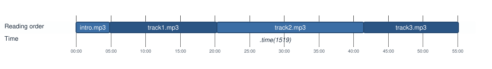

In the EPUB, the line is made of the 40 positions of the publication. A position is a stable chunk of content, independent of the screen size and font size.

<!--
```mermaid
---
displayMode: compact
---
gantt
    dateFormat HH:mm:ss
    axisFormat %-S
    tickInterval 5second
    section Reading order
    preface.xhtml        : 00:00:01, 00:00:06
    chapter1.xhtml       : 00:00:06, 00:00:14
    chapter2.xhtml       : 00:00:14, 00:00:26
    chapter2-part2.xhtml : 00:00:26, 00:00:33
    chapter3.xhtml       : 00:00:33, 00:00:41
    section Position
    .position(20) : milestone, 00:00:20, 1s
```
-->


A **`TimelinePosition`** is a point on this line. It is located by its reading order index and its offset in the resource. Its other properties are derived from these two. The positions above, 5 minutes into `track2.mp3` and halfway through `chapter2.xhtml`, are:

| Property            | Description                                                                                  | Audiobook     | EPUB            |
|---------------------|----------------------------------------------------------------------------------------------|---------------|-----------------|
| `readingOrderIndex` | Index of the resource in the reading order.                                                  | `2`           | `2`             |
| `offset`            | Offset in the resource, in a unit chosen by the timeline. Only compare it within a resource. | `300`         | `0.5`           |
| `coordinate`        | Where the position stands in the publication, in its natural unit.                           | `.time(1519)` | `.position(20)` |
| `progression`       | Progression in the resource, from 0 to 1.                                                    | `0.24`        | `0.5`           |
| `totalProgression`  | Progression in the publication, from 0 to 1.                                                 | `0.46`        | `0.475`         |

Call **`timeline.position(of:)`** to get the position of a `Locator`, such as the current location of the Navigator. It returns `nil` when the locator is outside the reading order.

`TimelinePosition` is not `Comparable`, because two positions at the same place can differ in their derived properties. Use **`isBefore(_:)`** to order them.

#### Units

A **`TimelineCoordinate`** tells where a position stands, and a **`TimelineLength`** measures the distance between two positions, in the natural unit of the publication:

| Publication                        | Coordinate                         | Length               |
|------------------------------------|------------------------------------|----------------------|
| Audiobook                          | `.time(seconds)` since the start   | `.duration(seconds)` |
| PDF                                | `.page(number)`                    | `.pages(count)`      |
| Comic (CBZ, DiViNa)                | `.page(number)`                    | `.pages(count)`      |
| Fixed-layout EPUB                  | `.page(number)`                    | `.pages(count)`      |
| Reflowable EPUB, HTML publication  | `.position(number)`                | `.positions(count)`  |

An EPUB is measured in pages only when all its resources have a fixed layout. An EPUB mixing reflowable and fixed-layout resources is measured in positions.

Page and position numbers start at 1. A `.position` matches the `locations.position` of a `Locator`, see the [Navigator guide](Navigator/Navigator.md#displaying-the-number-of-positions) for more about positions.

Call **`timeline.length(from:to:)`** to measure the distance between two positions.

> [!NOTE]
> The end of a chapter, or of the publication, is exclusive: it is one past its last page or position.

### Table of contents entries

`timeline.toc` is a **`TimelineTOC`**, a tree of **`TimelineTOCEntry`** mirroring the table of contents of the publication. Each entry has a `title`, a `link` and its `children`. The **depth** of an entry is its level in the tree, starting at 1 for the top level.

To place the entries on the timeline, the tree is flattened in pre-order: each entry comes before its children, and the children come before the next sibling of their parent.

<!--
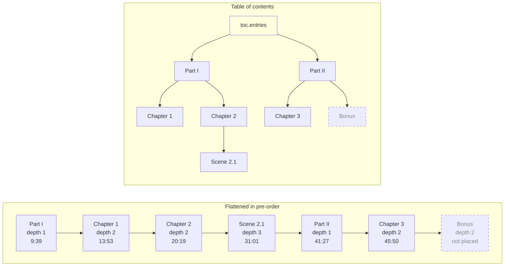
-->

Each entry then gets a range on the timeline:

* It starts where its link points, in its `start` property. `track1.mp3#t=287` is 4:47 into `track1.mp3`, which starts at 4:52, so Part I starts at 9:39.
* It ends at the start of the next placed entry after its subtree, or at the end of the publication, in its `end` property. Part I ends where Part II starts, at 41:27.
* Its `length` is the distance from its start to its end.

A parent therefore contains its children, and owns the gap before its first child: Part I alone covers 9:39 to 13:53.

<!--
```mermaid
---
displayMode: compact
---
gantt
    dateFormat HH:mm:ss
    axisFormat %M:%S
    section Reading order
    intro.mp3  : 00:00:00, 00:04:52
    track1.mp3 : 00:04:52, 00:20:19
    track2.mp3 : 00:20:19, 00:41:27
    track3.mp3 : 00:41:27, 00:55:08
    section Depth 1
    Part I  : active, 00:09:39, 00:41:27
    Part II : active, 00:41:27, 00:55:08
    section Depth 2
    Chapter 1 : active, 00:13:53, 00:20:19
    Chapter 2 : active, 00:20:19, 00:41:27
    Chapter 3 : active, 00:45:50, 00:55:08
    section Depth 3
    Scene 2.1 : active, 00:31:01, 00:41:27
```
-->
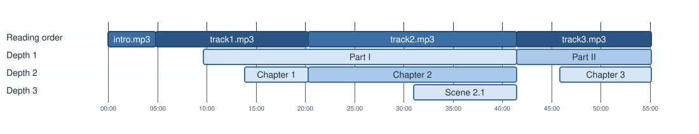

An entry cannot be placed when its link points outside the reading order, like Bonus, or before the start of the previous placed entry in pre-order. It keeps its place in the tree, but its `start`, `end` and `length` are `nil`.

### Segments

The entries overlap: at 25:19, you are both in Part I and in Chapter 2. **`timeline.segments(maxDepth:)`** cuts the reading order into **`TimelineSegment`** values following each other from the start of the publication to its end, without gaps or overlaps. Each segment matches the deepest entry containing it, in its `tocEntry` property.

<!--
```mermaid
---
displayMode: compact
---
gantt
    dateFormat HH:mm:ss
    axisFormat %M:%S
    section Reading order
    intro.mp3  : 00:00:00, 00:04:52
    track1.mp3 : 00:04:52, 00:20:19
    track2.mp3 : 00:20:19, 00:41:27
    track3.mp3 : 00:41:27, 00:55:08
    section segments()
    no entry  : done, 00:00:00, 00:04:52
    no entry  : done, 00:04:52, 00:09:39
    Part I    : active, 00:09:39, 00:13:53
    Chapter 1 : active, 00:13:53, 00:20:19
    Chapter 2 : active, 00:20:19, 00:31:01
    Scene 2.1 : active, 00:31:01, 00:41:27
    Part II   : active, 00:41:27, 00:45:50
    Chapter 3 : active, 00:45:50, 00:55:08
    section segments(maxDepth: 1)
    no entry : done, 00:00:00, 00:04:52
    no entry : done, 00:04:52, 00:09:39
    Part I   : active, 00:09:39, 00:41:27
    Part II  : active, 00:41:27, 00:55:08
```
-->


* A segment ends where another entry takes over. The segment of Part I ends at 13:53, where Chapter 1 starts, while the entry Part I goes on until 41:27.
* Outside any entry, such as before the first one or in a publication without a table of contents, there is one segment without entry per resource. Its `tocEntry` is `nil`. The segments therefore always cover the whole publication.
* `maxDepth` ignores the deeper entries: their positions belong to the segment of their closest ancestor within this depth. With `maxDepth: 1`, there is one segment per part.

In the EPUB, the preface is a segment without entry, and Section 2.2 splits Chapter 2 in two segments, unless you ignore it with `maxDepth: 1`. Section 2.1 is not placed, as explained in [Limitations](#entries-of-an-epub).

<!--
```mermaid
---
displayMode: compact
---
gantt
    dateFormat HH:mm:ss
    axisFormat %-S
    tickInterval 5second
    section Reading order
    preface.xhtml        : 00:00:01, 00:00:06
    chapter1.xhtml       : 00:00:06, 00:00:14
    chapter2.xhtml       : 00:00:14, 00:00:26
    chapter2-part2.xhtml : 00:00:26, 00:00:33
    chapter3.xhtml       : 00:00:33, 00:00:41
    section segments()
    no entry    : done, 00:00:01, 00:00:06
    Chapter 1   : active, 00:00:06, 00:00:14
    Chapter 2   : active, 00:00:14, 00:00:26
    #83;ection 2.2 : active, 00:00:26, 00:00:33
    Chapter 3   : active, 00:00:33, 00:00:41
    section segments(maxDepth: 1)
    no entry  : done, 00:00:01, 00:00:06
    Chapter 1 : active, 00:00:06, 00:00:14
    Chapter 2 : active, 00:00:14, 00:00:33
    Chapter 3 : active, 00:00:33, 00:00:41
```
-->
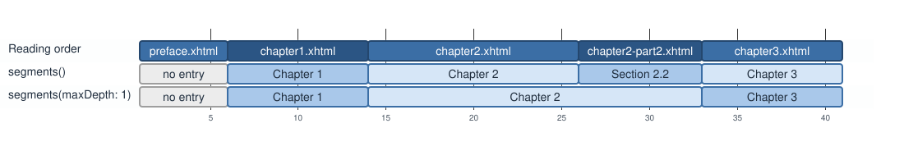

The `link` of a segment points to its start, so that you can go there with the Navigator.

## Getting the timeline of a publication

Call **`publication.timeline()`** to build the timeline, or get `nil` when the publication has no timeline service.

```swift
@_spi(ExperimentalTimeline) import ReadiumShared

let timeline: Timeline?
do {
    timeline = try await publication.timeline()
} catch {
    print("Failed to build the timeline: \(error)")
    timeline = nil
}

guard let timeline else {
    // Hide the features depending on the timeline.
    return
}

let segments = timeline.segments()
```

`segments(maxDepth:)` builds a new **`TimelineSegments`** collection at each call. You are responsible for keeping it while the publication is open, to locate each new location.

When the table of contents of the publication fails to load, you get a timeline without entries, whose segments still cover each resource.

## Displaying the table of contents

### Showing where each entry stands

Show the time, page or position where each entry starts.

```swift
extension TimelineTOCEntry {
    var trailingLabel: String? {
        switch start?.coordinate {
        case let .page(number), let .position(number):
            return "\(number)"
        case let .time(seconds):
            return Duration.seconds(seconds).formatted(.time(pattern: .hourMinuteSecond))
        case nil:
            return nil
        }
    }

    /// Children of the entry, or `nil` for a leaf, as expected by `List`.
    var nestedEntries: [TimelineTOCEntry]? {
        children.isEmpty ? nil : children
    }
}

struct TableOfContentsView: View {
    let toc: TimelineTOC
    let onSelect: (ReadiumShared.Link) -> Void

    var body: some View {
        List(toc.entries, children: \.nestedEntries) { entry in
            Button {
                onSelect(entry.link)
            } label: {
                HStack {
                    Text(entry.title)
                    Spacer()
                    if let label = entry.trailingLabel {
                        Text(label)
                            .monospacedDigit()
                            .foregroundStyle(.secondary)
                    }
                }
            }
        }
    }
}
```

When the user selects an entry, go to its link with **`navigator.go(to:)`**.

```swift
await navigator.go(to: link)
```

An entry that cannot be placed has no start nor length, so it shows its title only. Keep it in the list: its link may still be valid for the Navigator, such as an EPUB entry pointing to an anchor or outside the reading order (see [Limitations](#entries-of-an-epub)).

### Marking the current entry

The **`segment(containing:)`** method of `TimelineSegments` returns the segment containing a `Locator`, whose `tocEntry` is the current entry of the table of contents. Before the first entry, the segment has no `tocEntry`. The method returns `nil` only when the `Locator` is outside the reading order.

```swift
let currentEntry = navigator.currentLocation
    .flatMap { segments.segment(containing: $0) }?
    .tocEntry
```

**`toc.path(to:)`** returns the entries from the top level down to an entry, such as `[Part I, Chapter 2]` at 25:19. Use it to:

* expand the ancestors of the current entry when the table of contents opens, then scroll to it;
* mark the current entry, or its closest ancestor when the entry is hidden in a collapsed row.

In this sketch, `expandedIDs` holds the IDs of the expanded rows of your list, and `scrollTo` scrolls the list with a `ScrollViewReader`.

```swift
let currentPath = currentEntry.map { toc.path(to: $0).map(\.id) } ?? []

// When the table of contents opens.
expandedIDs.formUnion(currentPath.dropLast())
scrollTo(currentPath.last)

// For each visible row.
let isCurrent = entry.id == currentPath.last
    || (currentPath.contains(entry.id) && !expandedIDs.contains(entry.id))

Text(entry.title)
    .fontWeight(isCurrent ? .semibold : .regular)
    .accessibilityAddTraits(isCurrent ? .isSelected : [])
```

In the preface of the EPUB, there is no current entry, so no row is marked. An entry keeps its `id` when the timeline is rebuilt from the same table of contents, so you can keep the expanded entries across openings of the table of contents.

## Locating the current chapter

`segment(containing:)` runs a binary search, so you can call it at each location change of the Navigator. Pick the maximum depth of a "chapter" with the `maxDepth` parameter of `segments(maxDepth:)`.

> [!TIP]
> To detect when the reader enters another chapter, compare the `start` of the segments rather than the segments themselves. The equality of two segments compares their entries with their whole subtree, while the start of a segment is unique within its collection.

### Breadcrumbs as running header

Display the current entry with its ancestors.

```swift
func header(at locator: Locator) -> String? {
    guard
        let segment = segments.segment(containing: locator),
        let entry = segment.tocEntry
    else {
        return nil
    }
    return timeline.toc.path(to: entry)
        .map(\.title)
        .joined(separator: " › ")
}
```

At 25:19, the header is "Part I › Chapter 2".

### Previous and next chapter

**`segment(before:)`** and **`segment(after:)`** return the adjacent segments, which you can go to with their `link`. As the segments cover the whole publication, the listener can also reach the tracks before the first chapter.

```swift
func goToNextChapter() async {
    guard
        let locator = navigator.currentLocation,
        let current = segments.segment(containing: locator),
        let next = segments.segment(after: current)
    else {
        return
    }
    await navigator.go(to: next.link)
}
```

Like most audio players, the "previous" button can restart the current chapter, and go to the previous one only near its start:

```swift
func goToPreviousChapter() async {
    guard
        let locator = navigator.currentLocation,
        let position = timeline.position(of: locator),
        let current = segments.segment(containing: locator)
    else {
        return
    }

    let elapsed = timeline.length(from: current.start, to: position)?.seconds ?? 0
    let target = elapsed > 3 ? current : segments.segment(before: current) ?? current
    await navigator.go(to: target.link)
}
```

### Measuring what is left in the chapter

Measure the length from the current position to the end of its segment. The `end` of the last segment is `nil` when the length of the last resource is unknown.

```swift
func remainingInChapter(at locator: Locator) -> TimelineLength? {
    guard
        let position = timeline.position(of: locator),
        let end = segments.segment(containing: locator)?.end
    else {
        return nil
    }
    return timeline.length(from: position, to: end)
}
```

At position 20 of the EPUB, the length is `.positions(6)`: positions 20 to 25 are left before Section 2.2. At 25:19 in the audiobook, it is `.duration(342)`: 5:42 are left before Scene 2.1.

### Marking the chapters on the progress bar of a resource

When your progress bar shows the progression in the current resource, such as the current track of an audiobook, mark where each chapter starts on it. **`segments(in:)`** returns the segments of a single resource, clipped to it. The `progression` of their start goes from 0 to 1 in the resource.

```swift
let marks = segments.segments(in: locator.href)
    .compactMap(\.start.progression)
    .filter { $0 > 0 }
```

In `track1.mp3`, the marks are at 0.31 for Part I and 0.58 for Chapter 1.

## Limitations

### Entries of an EPUB

The timeline of an EPUB currently places only the first entry pointing to each resource, at the start of the resource. Section 2.1 points to an anchor in `chapter2.xhtml`, whose first entry is Chapter 2, so it is not placed. Section 2.2 is the first entry pointing to `chapter2-part2.xhtml`, so it starts there. Chapter 2 covers both of its resources, up to Chapter 3.

<!--
```mermaid
---
displayMode: compact
---
gantt
    dateFormat HH:mm:ss
    axisFormat %-S
    tickInterval 5second
    section Reading order
    preface.xhtml        : 00:00:01, 00:00:06
    chapter1.xhtml       : 00:00:06, 00:00:14
    chapter2.xhtml       : 00:00:14, 00:00:26
    chapter2-part2.xhtml : 00:00:26, 00:00:33
    chapter3.xhtml       : 00:00:33, 00:00:41
    section Depth 1
    Chapter 1 : active, 00:00:06, 00:00:14
    Chapter 2 : active, 00:00:14, 00:00:33
    Chapter 3 : active, 00:00:33, 00:00:41
    section Depth 2
    #83;ection 2.2 : active, 00:00:26, 00:00:33
```
-->
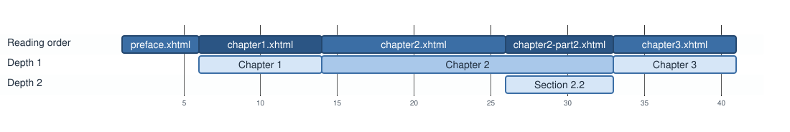

The current entry of an EPUB is therefore precise to the resource.

### Unknown lengths

When the length of a resource is unknown, such as an audiobook without the `duration` of its tracks, or a publication whose positions cannot be computed, the coordinates, progressions and lengths depending on it are `nil`. The entries are still placed, and the segments still locate the current chapter.